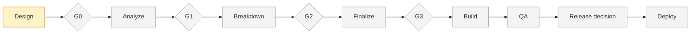

# Flow: eShareGoal: shared goals and group funds

**Orchestrator:** /flow:start · **Started:** 2026-10-25 · **Options:** mode hybrid, design frontend, scope (later)
**Status:** running
**Now:** Design: admin side first (preview runs as System Admin) · **Next:** Owner and Member views, then Gate 0 (your approval)

## Map

## Timeline

| #   | Time       | Step           | Who          | Result                                                                                                  | Files                                                       |
| --- | ---------- | -------------- | ------------ | ------------------------------------------------------------------------------------------------------- | ----------------------------------------------------------- |
| 1   | 2026-10-25 | Flow started   | orchestrator | Hybrid mode; inputs: tech analysis + user decisions (Neon + Next.js, fixed loan schedule, PHP, English) | [System Requirements.md](../../../System%20Requirements.md) |
| 2   | 2026-10-25 | Design started | frontend-dev | Design source: frontend (in code, no Figma)                                                             | —                                                           |
| 3   | 2026-10-26 | Design revision: Dashboard | orchestrator | New Dashboard screen: one accordion per joined group with your stats, 12-month activity chart, your part per goal, recent activity | [dashboard.tsx](../../../components/screens/dashboard.tsx) |
| 4   | 2026-10-26 | Design revision: Dashboard v2 | orchestrator | Nested accordions: groups > goals; each goal opens its own mini dashboard (3 stats, 12-month chart, your recent activity, link to the goal) | [dashboard.tsx](../../../components/screens/dashboard.tsx) |
| 5   | 2026-10-26 | Design revision: preview bar removed, All Goals screen | orchestrator | Preview bar removed from every screen. New All Goals screen: goals grouped by group, Joined / Not joined badge per card, card opens the goal | [screens.tsx](../../../components/screens/screens.tsx) |
| 6   | 2026-10-26 | Design revision: Goal info for non-joined goals | orchestrator | Goals you have not joined open a limited page: purpose, target, start date, status, who joined, Join button. No progress or records | [goal-info.tsx](../../../components/screens/goal-info.tsx) |
| 7   | 2026-10-26 | Fix: group page always showed Family | orchestrator | Group overview now takes ?group=; Friends has its own members, roles, funds, invite code and activity. Dashboard, My Groups and sidebar links point to the right group | [screens.tsx](../../../components/screens/screens.tsx) |
| 8   | 2026-10-26 | Design revision: roles and View as switch | orchestrator | Group roles are now Owner (changes anything) and Member (view only); System Admin is a site role, auto-joined to every group as a viewer and not counted. "View as" switch in the top bar; role indicator on the Dashboard and each group; Owner-only actions hidden for Member and Admin | [view-as.tsx](../../../components/app/view-as.tsx) |
| 9   | 2026-10-26 | Focus: admin side first | orchestrator | Preview now opens as System Admin by default (identity "System Admin", SA); Owner and Member stay in the View as switch for later | [view-as.ts](../../../lib/view-as.ts) |
| 10  | 2026-10-26 | Admin: no My Groups | orchestrator | My Groups hidden from the System Admin sidebar; /groups sends the admin to the Dashboard (All groups); breadcrumbs say All groups. Owners and Members keep My Groups | [shell.tsx](../../../components/app/shell.tsx) |
| 11  | 2026-10-26 | Activity History by role | orchestrator | New Activity History: one table across groups with search, group/goal/member/type/status/source/date filters, Issues only, detail dialog with audit trail, CSV export. System Admin sees every group; Owner and Member only goals they joined | [activity.tsx](../../../components/screens/activity.tsx) |
| 12  | 2026-10-26 | Activity History: sections and pages | orchestrator | Records grouped in accordions by Group / Goal (plus Group / Whole group), each with its own Previous / Next pages (10 rows). Member filter lists real users only | [activity.tsx](../../../components/screens/activity.tsx) |
| 13  | 2026-10-26 | Activity History: group > goal > table | orchestrator | Outer accordion per group, inner accordion per goal (plus Whole group); each goal has its own search, From/To, Status, Source, Member, Type, Issues only, CSV and Previous/Next table. Global filter bar removed | [activity.tsx](../../../components/screens/activity.tsx) |
| 14  | 2026-10-26 | Sections by role | orchestrator | Sidebar and pages follow role: Owner gets Notifications, Integrations (Gmail, Calendar, Sheets, import rules and history moved from Settings) and new Scheduled Jobs (cron); System Admin gets new Users page (all accounts, groups and roles, read-only); Member gets neither. Settings: Groups and goals and Notifications are Owner-only | [screens.ts](../../../lib/screens.ts) |
| 15  | 2026-10-26 | Admin: review, revoke, transfer, reports, email mode | orchestrator | Sign-up asks for a valid ID and selfie; account waits as Pending review. Users: approve or reject (reason), revoke access (new Owner required for each owned group), restore, transfer ownership; admin history per user. New Reports inbox (issues, user reports, disputes, sign-up flags, system) with review, resolve and dismiss. Settings, Email delivery: production or development (simulated) | [users.tsx](../../../components/screens/users.tsx) |
| 16  | 2026-10-26 | Fix: savings goals showed Emergency Fund | orchestrator | Savings goal page now takes ?goal= and computes totals, charts and per-member table from that goal's records (Emergency Fund, Grocery Budget as a monthly budget, Vacation Fund). Breadcrumb and sidebar follow the goal | [screens.tsx](../../../components/screens/screens.tsx) |
| 17  | 2026-10-26 | Create group: creator is Owner | orchestrator | Owners and Members can create a group (name, description, email invites); the creator is its Owner there even while a Member elsewhere. Shows in My Groups, sidebar and Dashboard; can add goals, manage invites and delete. System Admin cannot create groups | [create-group.tsx](../../../components/app/create-group.tsx) |
| 18  | 2026-10-26 | Admin goal templates | orchestrator | New Goal Templates page (System Admin): build a template (name, icon, what it measures, fields Owners fill in, dashboard sections in order, live preview), save as draft or publish. Published templates appear in Create goal for Owners, with their fields and dashboard preview. Built-in templates listed read-only | [templates.tsx](../../../components/screens/templates.tsx) |
| 19  | 2026-10-26 | Create goal works; no group funds | orchestrator | Create goal now saves the goal (with a copy of its template) and opens its dashboard built from the template sections. Group list in the form = groups you own (incl. ones you created). New goals show in the group, sidebar, All Goals and Dashboard; Owner can delete. Available Group Funds removed from group pages. Phone header fixed; all pages checked at 375, 768 and 1280 px with no overflow | [goal-page.tsx](../../../components/screens/goal-page.tsx) |
| 20  | 2026-10-26 | Owner CRUD; members can become Owners | orchestrator | Owners can create, edit and delete records (deposits, payments, progress, tasks), goals (edit name, status, details) and groups (edit, invite, remove, delete). Goal dashboards are computed from records; every goal page always has a record list. Group creator can make a joined Member an Owner (and back); creator stays Owner. Records stored in browser localStorage; cookie size guarded | [goal-page.tsx](../../../components/screens/goal-page.tsx) |
| 21  | 2026-10-26 | Created groups look like the others | orchestrator | Groups you create now use the same My Groups card (goal progress rows, Open group), sidebar tree (arrow, goals inside), Dashboard item (goal accordion with mini dashboard) and group page layout as Family and Friends. Fixed "$1 goals" and wrong member count | [created-group.tsx](../../../components/screens/created-group.tsx) |
| 22  | 2026-10-26 | Single or per-member goals | orchestrator | Create goal (and Edit goal) asks who the goal is for: one shared goal, or each member has their own copy of the target (pick who takes part). Per-member goals show each person's progress, how many reached the target, average progress, milestones counted per person | [new-goal.tsx](../../../components/screens/new-goal.tsx) |
| 23  | 2026-10-26 | Walking Club demo | orchestrator | "Load walking demo" on My Groups adds Walking Club: Bernz (Owner) plus 4 dummy members (Ana Cruz, Ben Reyes, Carlo Santos, Dana Lim) and a "Walk 10,000 km" goal for each member with six months of walks. Dummy accounts also listed on the admin Users page | [walking-demo.ts](../../../lib/walking-demo.ts) |
| 24  | 2026-10-26 | Walking demo visible to everyone | orchestrator | Walking Club demo now loads automatically on the first visit (any role); deleting it sticks, "Load walking demo" restores it. System Admin now sees created groups (sidebar, Dashboard, All Goals, group and goal pages) read-only | [demo-seeder.tsx](../../../components/app/demo-seeder.tsx) |
| 25  | 2026-10-26 | Admin-controlled goal types | orchestrator | Template fields are Owner fills / Suggested / Locked; admin fixes single vs each (or lets Owner choose) and which groups can use a template; Ready-made goals section in Create goal; templates in use can only be retired (built-ins too); dashboard edits reach existing goals; Owners can request a goal type (shows in Reports, admin builds or rejects). View as now: Admin / User 1 (Owner) / User 2 (Member) | [goal-templates.ts](../../../lib/goal-templates.ts) |
| 26  | 2026-10-26 | Roles per group | orchestrator | Account types are only System Admin and User. View as: Admin / User 1 (Bernz) / User 2 (Babylyn). Owner or Member is decided per group: Bernz owns Family and Walking Club and is a Member of Friends (Carla owns it); Babylyn is a Member of Family and Owner of any group she creates. Owner pages (Notifications, Integrations, Jobs) show once a user owns a group | [accounts.ts](../../../lib/accounts.ts) |
| 27  | 2026-10-26 | Group settings | orchestrator | Integrations, Scheduled jobs and Notifications moved from the sidebar into each group: Group settings (tabs) per group, Owners edit, System Admin read-only, Members see a "Group setup" summary only. Jobs depend on the group (Gmail jobs need Gmail; due-date jobs need a loan goal). Bell inbox groups notifications by group. Personal Settings keeps General, Account, Privacy (+ Email delivery for admin) | [group-settings.tsx](../../../components/screens/group-settings.tsx) |
| 28  | 2026-10-26 | Setup on the group page | orchestrator | Group setup (Integrations, Scheduled jobs, Notifications tabs) now lives only on the group (parent) page; the separate Group settings page and sidebar link were removed. Owners edit, System Admin read-only, Members see a summary card. Links open the right tab via /group?group=<id>&tab=<tab>#setup | [group-settings.tsx](../../../components/screens/group-settings.tsx) |
| 29  | 2026-10-26 | Setup per sub group | orchestrator | Group setup on the parent page is now an accordion: "Whole group" (scheduled jobs, notifications) plus one row per goal (integrations, jobs, notifications for that goal). Each row shows its summary; Owners open a row to add or change it. Gmail jobs appear per goal once Gmail is connected to it; due-date jobs only on loan goals | [group-settings.tsx](../../../components/screens/group-settings.tsx) |
| 30  | 2026-10-27 | Setup per goal only | orchestrator | Removed the "Whole group" setup row: integrations, scheduled jobs and notifications are set per goal (sub group) only, listed on the parent group page as "Goal setup". The monthly summary, participant updates and email copies are now per goal | [group-settings.tsx](../../../components/screens/group-settings.tsx) |
| 31  | 2026-10-27 | Gmail import per goal | orchestrator | Removed "Change role" from sample group members. Gmail integration per goal: Test connection, "How to connect Gmail" help, 4 steps: filter (from / subject / email contains, shown as a Gmail search), read each email into JSON (amount, sender, account suffix, reference, date), map sender name or account suffix to a member, then add the mapped deposits to that member in the goal (created money goals) or send them to Import review (sample goals); duplicates skipped by reference. Emails are fictional samples | [gmail-setup.tsx](../../../components/screens/gmail-setup.tsx) |

## Decisions

| Gate     | Decision                                                                                                                                                                  | By   | Note                       |
| -------- | ------------------------------------------------------------------------------------------------------------------------------------------------------------------------- | ---- | -------------------------- |
| Pre-spec | Real multi-user app with seeded demo data; Neon + Next.js on Vercel; fixed-schedule loans; pending counts toward funds; archive and delete; mock Gmail; PHP; English only | user | From the tech analysis Q&A |
| Roles | Group roles: Owner (updates anything in the group and its goals, records every transaction) and Member (view only). System Admin: site role, auto-joined to every group as a viewer, listed separately, not counted in members, totals or charts. Replaces the four roles in System Requirements.md | user | 2026-10-26; the server must enforce these, the UI only hides actions |
| Activity scope | System Admin sees all activity in every group (to investigate issues); Owners and Members see only activity of goals they joined, plus group-level changes in their groups | user | 2026-10-26; the server applies this filter, the page only mirrors it |
| Sections by role | Owner: Notifications, Integrations, Scheduled Jobs, Groups and goals settings. System Admin: Users (all accounts), no Notifications, Integrations or My Groups. Member: view-only pages | user | 2026-10-26; pages are also blocked by role, not only hidden |
| Sign-up review | New accounts submit a valid ID and selfie and stay Pending review until a System Admin approves or rejects (reason required). Revoking a user who owns groups requires a new Owner for each group first. A switch picks real email (production) or simulated notices (development) | user | 2026-10-26; ID images must be stored encrypted with every admin view logged |
| Roles per group | Roles are per group: whoever creates a group is its Owner, even if they are a Member in other groups. System Admins do not create groups | user | 2026-10-26 |
| Goal templates | System Admins create goal templates and choose each one's dashboard sections; only published templates reach Owners in Create goal. Goals keep their dashboard if a template changes or is deleted | user | 2026-10-26 |
| Owner rights | Owners of a group have full create, read, update and delete on its goals, records and members. The group creator can make a Member an Owner (several Owners allowed) or back to Member; the creator always stays Owner. Members stay view-only | user | 2026-10-26 |
| Goal scope | A goal is either one shared target for the group, or one target per participating member (same target for each, e.g. 10,000 km each). Overall progress of a per-member goal is the average of members' progress | user | 2026-10-26 |
| Goal types | System Admin defines goal types (fields with locked/suggested values, single or each, available groups, dashboard). Owners pick one and fill only the open fields and participants. Templates in use are retired, not deleted; dashboard changes apply to existing goals, entered values stay | user | 2026-10-26 |
| Account types | Only two account types: System Admin and User. Owner and Member are roles inside a group: a user is Owner of the groups they created or were made Owner of, and a Member elsewhere | user | 2026-10-26 |
| Group settings | Integrations, scheduled jobs and notification settings belong to each goal (sub group), listed on the parent group page; there is no group-wide setup | user | 2026-10-26 |
| Gmail import | Bank emails are filtered (sender, subject, text), read into JSON, and each deposit is assigned to a member by a sender-name or account-suffix map; the deposit is then recorded for that member in the goal | user | 2026-10-27 |
