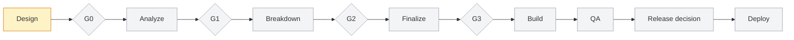

# Flow: eShareGoal: shared goals and group funds

**Orchestrator:** /flow:start · **Started:** 2026-10-25 · **Options:** mode hybrid, design frontend, scope (later)
**Status:** running
**Now:** Design: admin side first (preview runs as System Admin) · **Next:** Owner and Member views, then Gate 0 (your approval)

## Map

## Timeline

| #   | Time       | Step           | Who          | Result                                                                                                  | Files                                                       |
| --- | ---------- | -------------- | ------------ | ------------------------------------------------------------------------------------------------------- | ----------------------------------------------------------- |
| 1   | 2026-10-25 | Flow started   | orchestrator | Hybrid mode; inputs: tech analysis + user decisions (Neon + Next.js, fixed loan schedule, PHP, English) | [System Requirements.md](../../../System%20Requirements.md) |
| 2   | 2026-10-25 | Design started | frontend-dev | Design source: frontend (in code, no Figma)                                                             | —                                                           |
| 3   | 2026-10-26 | Design revision: Dashboard | orchestrator | New Dashboard screen: one accordion per joined group with your stats, 12-month activity chart, your part per goal, recent activity | [dashboard.tsx](../../../components/screens/dashboard.tsx) |
| 4   | 2026-10-26 | Design revision: Dashboard v2 | orchestrator | Nested accordions: groups > goals; each goal opens its own mini dashboard (3 stats, 12-month chart, your recent activity, link to the goal) | [dashboard.tsx](../../../components/screens/dashboard.tsx) |
| 5   | 2026-10-26 | Design revision: preview bar removed, All Goals screen | orchestrator | Preview bar removed from every screen. New All Goals screen: goals grouped by group, Joined / Not joined badge per card, card opens the goal | [screens.tsx](../../../components/screens/screens.tsx) |
| 6   | 2026-10-26 | Design revision: Goal info for non-joined goals | orchestrator | Goals you have not joined open a limited page: purpose, target, start date, status, who joined, Join button. No progress or records | [goal-info.tsx](../../../components/screens/goal-info.tsx) |
| 7   | 2026-10-26 | Fix: group page always showed Family | orchestrator | Group overview now takes ?group=; Friends has its own members, roles, funds, invite code and activity. Dashboard, My Groups and sidebar links point to the right group | [screens.tsx](../../../components/screens/screens.tsx) |
| 8   | 2026-10-26 | Design revision: roles and View as switch | orchestrator | Group roles are now Owner (changes anything) and Member (view only); System Admin is a site role, auto-joined to every group as a viewer and not counted. "View as" switch in the top bar; role indicator on the Dashboard and each group; Owner-only actions hidden for Member and Admin | [view-as.tsx](../../../components/app/view-as.tsx) |
| 9   | 2026-10-26 | Focus: admin side first | orchestrator | Preview now opens as System Admin by default (identity "System Admin", SA); Owner and Member stay in the View as switch for later | [view-as.ts](../../../lib/view-as.ts) |
| 10  | 2026-10-26 | Admin: no My Groups | orchestrator | My Groups hidden from the System Admin sidebar; /groups sends the admin to the Dashboard (All groups); breadcrumbs say All groups. Owners and Members keep My Groups | [shell.tsx](../../../components/app/shell.tsx) |
| 11  | 2026-10-26 | Activity History by role | orchestrator | New Activity History: one table across groups with search, group/goal/member/type/status/source/date filters, Issues only, detail dialog with audit trail, CSV export. System Admin sees every group; Owner and Member only goals they joined | [activity.tsx](../../../components/screens/activity.tsx) |
| 12  | 2026-10-26 | Activity History: sections and pages | orchestrator | Records grouped in accordions by Group / Goal (plus Group / Whole group), each with its own Previous / Next pages (10 rows). Member filter lists real users only | [activity.tsx](../../../components/screens/activity.tsx) |
| 13  | 2026-10-26 | Activity History: group > goal > table | orchestrator | Outer accordion per group, inner accordion per goal (plus Whole group); each goal has its own search, From/To, Status, Source, Member, Type, Issues only, CSV and Previous/Next table. Global filter bar removed | [activity.tsx](../../../components/screens/activity.tsx) |
| 14  | 2026-10-26 | Sections by role | orchestrator | Sidebar and pages follow role: Owner gets Notifications, Integrations (Gmail, Calendar, Sheets, import rules and history moved from Settings) and new Scheduled Jobs (cron); System Admin gets new Users page (all accounts, groups and roles, read-only); Member gets neither. Settings: Groups and goals and Notifications are Owner-only | [screens.ts](../../../lib/screens.ts) |
| 15  | 2026-10-26 | Admin: review, revoke, transfer, reports, email mode | orchestrator | Sign-up asks for a valid ID and selfie; account waits as Pending review. Users: approve or reject (reason), revoke access (new Owner required for each owned group), restore, transfer ownership; admin history per user. New Reports inbox (issues, user reports, disputes, sign-up flags, system) with review, resolve and dismiss. Settings, Email delivery: production or development (simulated) | [users.tsx](../../../components/screens/users.tsx) |

## Decisions

| Gate     | Decision                                                                                                                                                                  | By   | Note                       |
| -------- | ------------------------------------------------------------------------------------------------------------------------------------------------------------------------- | ---- | -------------------------- |
| Pre-spec | Real multi-user app with seeded demo data; Neon + Next.js on Vercel; fixed-schedule loans; pending counts toward funds; archive and delete; mock Gmail; PHP; English only | user | From the tech analysis Q&A |
| Roles | Group roles: Owner (updates anything in the group and its goals, records every transaction) and Member (view only). System Admin: site role, auto-joined to every group as a viewer, listed separately, not counted in members, totals or charts. Replaces the four roles in System Requirements.md | user | 2026-10-26; the server must enforce these, the UI only hides actions |
| Activity scope | System Admin sees all activity in every group (to investigate issues); Owners and Members see only activity of goals they joined, plus group-level changes in their groups | user | 2026-10-26; the server applies this filter, the page only mirrors it |
| Sections by role | Owner: Notifications, Integrations, Scheduled Jobs, Groups and goals settings. System Admin: Users (all accounts), no Notifications, Integrations or My Groups. Member: view-only pages | user | 2026-10-26; pages are also blocked by role, not only hidden |
| Sign-up review | New accounts submit a valid ID and selfie and stay Pending review until a System Admin approves or rejects (reason required). Revoking a user who owns groups requires a new Owner for each group first. A switch picks real email (production) or simulated notices (development) | user | 2026-10-26; ID images must be stored encrypted with every admin view logged |
